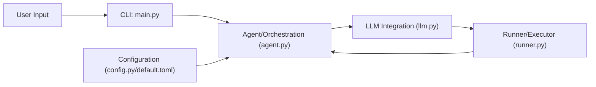

# knownsec/aipyapp

> Command-line client where an LLM writes and runs Python to accomplish a task described in natural language.

## The problem
Chaining API calls, scripts and libraries for a one-off task requires coding every step yourself, or installing several agent tools.

## What it actually does
You describe a task; the LLM plans, generates Python, runs it on your machine, reads the result and corrects until done. Two modes: task (default) and Python (`--python`, with the `ai("…")` function). When the code needs a third-party library, the tool asks for confirmation (`y/n`) before installing it. Configuration is in `~/.aipyapp/aipyapp.toml`. According to the code: `agent.py`, `llm.py`, `runner.py`.

## How it is wired


## Trying it
```bash
pip install aipyapp
aipy
aipy --python
```
The `~/.aipyapp/aipyapp.toml` file must declare a provider, for example `[llm.deepseek]` with `type` and `api_key`.

## Cost and gotchas
You pay for calls to the chosen LLM (API key). The generated code runs in your real environment: the README presents this as an asset and describes no sandbox. License present but not identified by GitHub. Displayed version 0.1.22: young.

## What it is not
It is not a code generator or an IDE, according to the README: the result matters, not the code. The manifesto ("no agents, no MCP") is the author's stance, not proof of superiority; no measurement is provided.

## Alternatives
No alternative cited in the README (it only names the approaches it rejects: function calling, MCP, workflows).

## For you
Keep an eye on it: the idea of letting the model drive an interpreter is interesting for data exploration, but running generated code without isolation on your machine means you should test it in a container.
