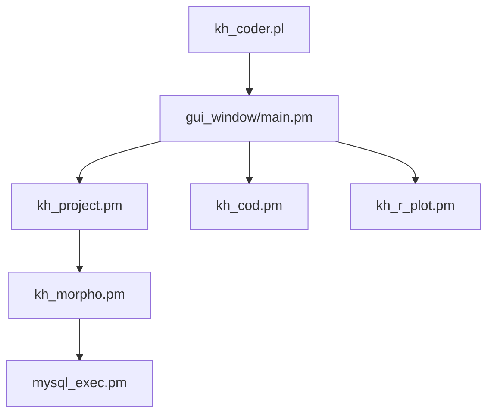

# ko-ichi-h/khcoder

> Quantitative content analysis and text mining software, written in Perl, with R statistics.

## The problem
Quantitatively analyzing large text corpora in the social sciences without programming.

## What it actually does
KH Coder loads a project, splits the text into words, stores it in MySQL, applies coding rules and draws charts through R. It handles several languages including French, English and Japanese. The README states that this repository is mainly for discussions and that the code is an old beta version.

## How it is wired
Diagram based on the code diagram.

## Trying it
No documented command.

## Cost and gotchas
Free. Perl/Tk, MySQL and R are required according to the architecture. The published code is outdated: get the up-to-date version from the website.

## What it is not
This repository is not the current version of the software. It is not a modern NLP tool (no language models).

## Alternatives
No alternative named in the README.

## For you
Ignore: obsolete code and an old stack; for text work, recent Python libraries are a better fit.
