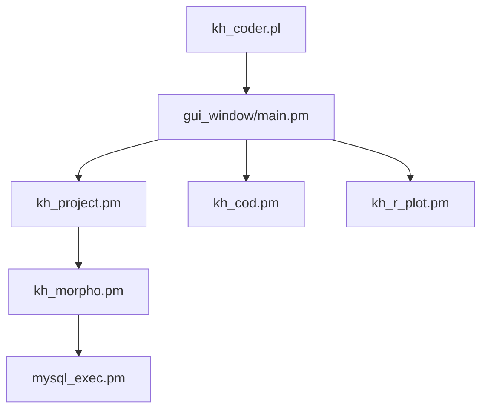

# ko-ichi-h/khcoder

> Logiciel d'analyse de contenu quantitative et de fouille de textes, en Perl, avec statistiques R.

## Le problème
Analyser quantitativement de gros corpus de texte en sciences sociales sans programmer.

## Ce que ça fait vraiment
KH Coder charge un projet, découpe le texte en mots, stocke dans MySQL, applique des règles de codage et trace des graphiques via R. Il traite plusieurs langues dont le français, l'anglais et le japonais. Le README précise que ce dépôt sert surtout aux discussions et que le code est une ancienne version bêta.

## Comment c'est branché
Schéma d'après le diagramme du code.

## Essayer
Aucune commande documentée.

## Coût et pièges
Gratuit. Perl/Tk, MySQL et R sont nécessaires d'après l'architecture. Le code publié est périmé : récupérer la version à jour sur le site.

## Ce que ce n'est pas
Ce dépôt n'est pas la version actuelle du logiciel. Ce n'est pas un outil de NLP moderne (pas de modèles de langage).

## Alternatives
Aucune alternative nommée dans le README.

## Pour toi
À ignorer : code obsolète et pile ancienne ; pour du texte, des bibliothèques Python récentes sont plus adaptées.

