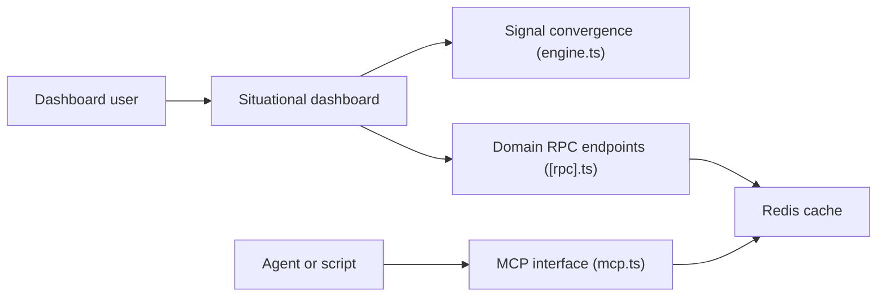

# koala73/worldmonitor

> Real-time dashboard for geopolitical monitoring, market and infrastructure analysis, with API, CLI, and MCP server.

## The problem
Keeping up with global news, markets, risks, and military signals requires managing a wide range of disparate sources.

## What it actually does
A web application (TypeScript, Vite, globe.gl, deck.gl) aggregates data streams, generates syntheses using AI, calculates an instability index per country (CII, for 31 countries), cross-references signals, and proposes variations (technology, finance, energy…). Accessible via a Tauri app, a terminal dashboard, a CLI, a Python/Ruby/Go SDK, and a MCP. The AI can run via Ollama without a key.

## How it is wired


## Trying it
```bash
git clone https://github.com/koala73/worldmonitor.git
cd worldmonitor
npm install
npm run dev
npx worldmonitor tools
```

## Cost and gotchas
It functions without using environment variables, but some sources require credentials; authenticated access to the MCP/API requires a key (worldmonitor.app/pro). AGPL-3.0 license: obligations if you offer the service to third parties.

## What it is not
Not a verified source of information: it is an aggregator where the CII index is a proprietary score. The flight data comes from Wingbits.

## Alternatives
- No alternative is specified in the README file.

## For you
Things to watch out for: Interesting as an example of real-time architecture and MCP server, but outside the scope of your data/MLOps; the AGPL license limits commercial reuse.
