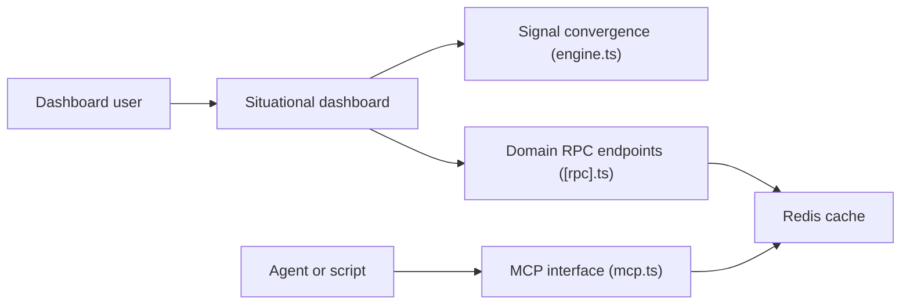

# koala73/worldmonitor

> Tableau de bord en temps réel de veille géopolitique, marchés et infrastructures, avec API, CLI et serveur MCP.

## Le problème
Suivre l'actualité mondiale, les marchés, les risques et les signaux militaires exige de jongler entre de nombreux flux dispersés.

## Ce que ça fait vraiment
Une app web (TypeScript, Vite, globe.gl, deck.gl) agrège des flux, produit des synthèses par IA, calcule un indice d'instabilité par pays (CII, 31 pays), croise des signaux et propose des variantes (tech, finance, énergie…). Accessible en app Tauri, tableau de bord terminal, CLI, SDK Python/Ruby/Go et MCP. L'IA peut tourner via Ollama sans clé.

## Comment c'est branché


## Essayer
```bash
git clone https://github.com/koala73/worldmonitor.git
cd worldmonitor
npm install
npm run dev
npx worldmonitor tools
```

## Coût et pièges
Fonctionne sans variable d'environnement, mais certaines sources demandent des identifiants ; l'accès MCP/API authentifié passe par une clé (worldmonitor.app/pro). Licence AGPL-3.0 : obligations si tu proposes le service à des tiers.

## Ce que ce n'est pas
Pas une source de renseignement vérifiée : c'est un agrégateur dont l'indice CII est un score maison. Les données de vol viennent de Wingbits.

## Alternatives
- Aucune alternative nommée dans le README.

## Pour toi
À surveiller : intéressant comme exemple d'architecture temps réel et de serveur MCP, mais hors de ton cœur data/MLOps ; l'AGPL limite la réutilisation commerciale.

