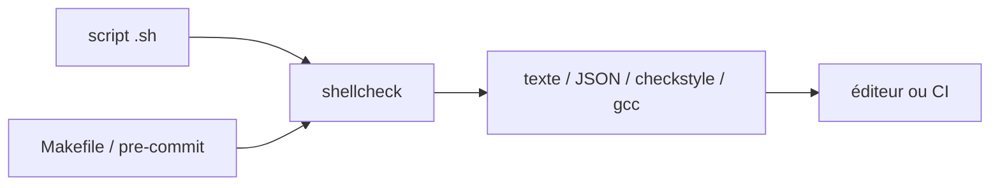

# koalaman/shellcheck

> Static analyzer for bash/sh scripts that flags syntax errors, pitfalls and portability issues, for any developer.

## The problem
A badly quoted or malformed shell script fails cryptically, or works today and breaks tomorrow. Without static analysis, these defects only show up at runtime.

## What it actually does
Reads a script and emits categorized warnings: quoting, conditionals, misused commands, beginner mistakes, style, typing, robustness, portability according to the shebang. Outputs plain text, JSON, CheckStyle XML or GCC format, with exit codes usable in CI. Available online (shellcheck.net), as a CLI and in many editors.

## How it is wired


## Trying it
```bash
shellcheck yourscript
docker run --rm -v "$PWD:/mnt" koalaman/shellcheck:stable myscript
sudo apt install shellcheck
brew install shellcheck
```

## Cost and gotchas
Free, no account. Building from source (Haskell/Cabal) requires 2 GB of RAM. Pinning a version in CI avoids breakage caused by new warnings.

## What it is not
Not a formatter: it enforces no indentation style (see shfmt). Not a guarantee of correctness: it detects known patterns, not the full semantics of a script.

## Alternatives
- shfmt: for formatting, which ShellCheck does not do (cited in the README).
- checkbashisms: close for portability, which ShellCheck already covers (cited in the README).

## For you
Adopt: wire it into pre-commit and CI on your MLOps pipeline scripts; it cheaply catches the quoting errors that break jobs.
