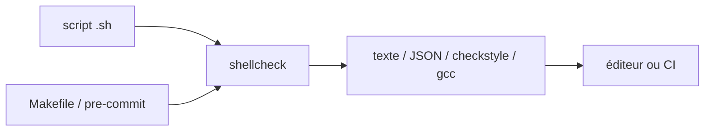

# koalaman/shellcheck

> Analyseur statique de scripts bash/sh qui signale erreurs de syntaxe, pièges et problèmes de portabilité, pour tout développeur.

## Le problème
Un script shell mal quoté ou mal formé échoue de façon cryptique, ou marche aujourd'hui et casse demain. Sans analyse statique, ces défauts ne se voient qu'à l'exécution.

## Ce que ça fait vraiment
Lit un script et émet des avertissements classés : quoting, conditionnelles, commandes mal utilisées, erreurs de débutant, style, typage, robustesse, portabilité selon le shebang. Sort en texte, JSON, XML CheckStyle ou format GCC, avec des codes de retour exploitables en CI. Existe en ligne (shellcheck.net), en CLI et dans de nombreux éditeurs.

## Comment c'est branché


## Essayer
```bash
shellcheck yourscript
docker run --rm -v "$PWD:/mnt" koalaman/shellcheck:stable myscript
sudo apt install shellcheck
brew install shellcheck
```

## Coût et pièges
Gratuit, aucun compte. Compiler depuis les sources (Haskell/Cabal) demande 2 Go de RAM. Épingler une version en CI évite les ruptures dues à de nouveaux avertissements.

## Ce que ce n'est pas
Pas un formateur : il n'impose aucun style d'indentation (voir shfmt). Pas une garantie de correction : il détecte des motifs connus, pas toute la sémantique d'un script.

## Alternatives
- shfmt : pour le formatage, que ShellCheck ne fait pas (cité dans le README).
- checkbashisms : proche pour la portabilité, ShellCheck la couvre déjà (cité dans le README).

## Pour toi
Adopter : à brancher en pre-commit et en CI sur tes scripts de pipelines MLOps, il attrape à bas coût les erreurs de quoting qui cassent les jobs.

