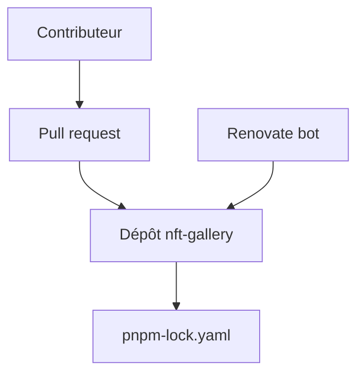

# kodadot/nft-gallery

> KodaDot generative art marketplace, archived repository, almost empty README.

## The problem
Not documented in the README provided.

## What it actually does
The README only mentions a generative art marketplace, a $DOT reward system for contributors and a lockfile update tip. Nothing else is documented.

## How it is wired
Simplified diagram based on the sheet, no diagram provided.



## Trying it
```bash
git checkout origin/main pnpm-lock.yaml && pnpm install
```

## Cost and gotchas
Not documented. Archived repository, 567 open issues.

## What it is not
It is not usage documentation: the README says neither how to run the application nor what it requires.

## Alternatives
No alternative named in the README.

## For you
Ignore: archived, undocumented and outside the data, AI or MLOps scope.
