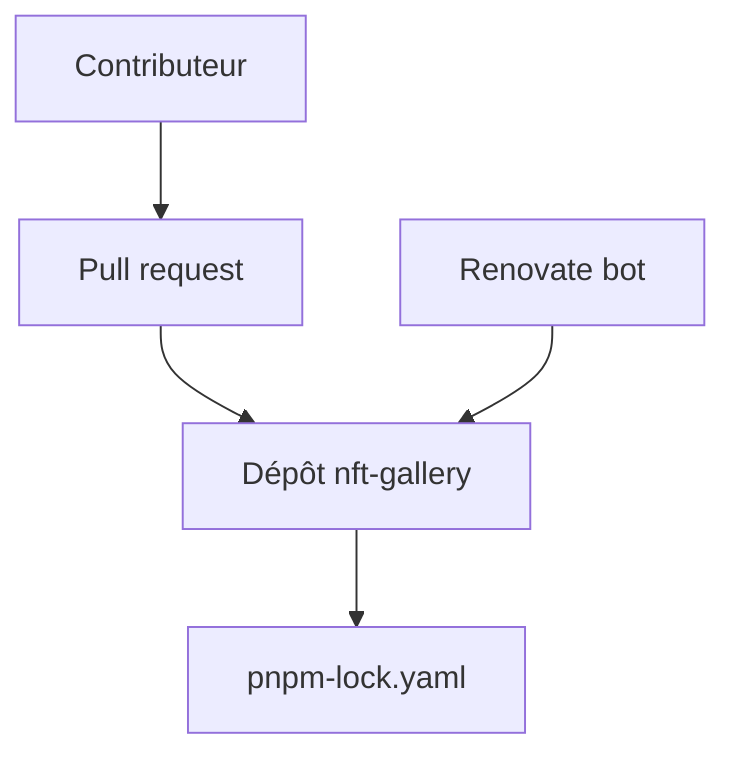

# kodadot/nft-gallery

> Place de marché d'art génératif de KodaDot, dépôt archivé, README quasi vide.

## Le problème
Non documenté dans le README fourni.

## Ce que ça fait vraiment
Le README indique seulement une place de marché d'art génératif, un système de récompenses en $DOT pour les contributeurs et une astuce de mise à jour du lockfile. Rien d'autre n'est documenté.

## Comment c'est branché
Schéma simplifié d'après la fiche, sans diagramme fourni.



## Essayer
```bash
git checkout origin/main pnpm-lock.yaml && pnpm install
```

## Coût et pièges
Non documenté. Dépôt archivé, 567 issues ouvertes.

## Ce que ce n'est pas
Ce n'est pas une documentation d'utilisation : le README ne dit ni comment lancer l'application ni ce qu'elle exige.

## Alternatives
Aucune alternative nommée dans le README.

## Pour toi
À ignorer : archivé, sans documentation et hors du périmètre data, IA ou MLOps.

