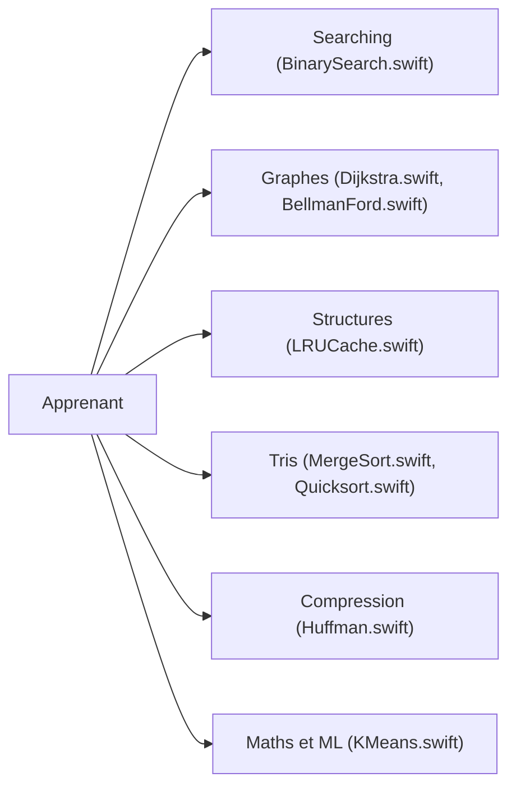

# kodecocodes/swift-algorithm-club

> Educational collection of algorithms and data structures in Swift, explained step by step.

## The problem
Learning classic algorithms and data structures in Swift calls for clear explanations rather than opaque libraries.

## What it actually does
One folder per topic with an explanation and a Swift implementation: search, strings, sorting, compression (Huffman, RLE), mathematics, structures (stacks, queues, trees, heaps, hash tables, graphs), a few machine-learning algorithms (k-means, linear regression, Naive Bayes) and interview puzzles. The README states that the goal is clarity, not a reusable library.

## How it is wired

## Trying it
No documented command: open an algorithm folder and its playground in Xcode.

## Cost and gotchas
Free. Code declared compatible with Xcode 10 and Swift 4.2, with a last push on 2024-12-06: adapt it to recent versions. The README points to a paid book.

## What it is not
Not a library to depend on. The learning sections are toy examples, not an ML tool.

## Alternatives
No alternative cited in the README.

## For you
Ignore: Swift, old and educational, of no direct use for a data/AI/MLOps profile; its only value: reviewing algorithmic basics.
