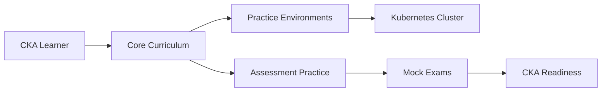

# kodekloudhub/certified-kubernetes-administrator-course

> Markdown course notes to prepare for the Kubernetes CKA certification, taken from the KodeKloud course.

## The problem
Preparing for the CKA means covering a vast syllabus: architecture, networking, storage, security, troubleshooting.

## What it actually does
A tree of notes organized by section (concepts, scheduling, security, storage, networking, kubeadm installation, troubleshooting), with "practice tests", mock exams and lightning labs. The README is only the table of contents. The sampled code is limited to a lab script generator.

## How it is wired


## Trying it
```bash
# Aucune commande documentée dans le README : parcourir les dossiers dans l'ordre.
```

## Cost and gotchas
The notes are free, but the labs and the associated video course are on the KodeKloud platform (account required, not detailed). Part of the content points to external "presentation decks".

## What it is not
Not the full course: these are notes, without the videos. No license declared: reuse is uncertain. The CKA syllabus evolves, and the README does not guarantee freshness.

## Alternatives
No alternative named in the README.

## For you
Keep an eye on it: useful as a memory aid if you take the CKA or operate an MLOps cluster, but it does not replace practice on a real cluster.
