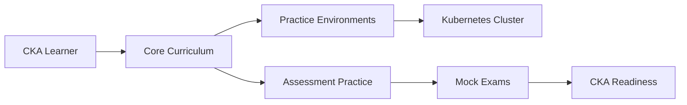

# kodekloudhub/certified-kubernetes-administrator-course

> Notes de cours Markdown pour préparer la certification Kubernetes CKA, issues du cours KodeKloud.

## Le problème
Préparer la CKA oblige à couvrir un programme vaste : architecture, réseau, stockage, sécurité, dépannage.

## Ce que ça fait vraiment
Une arborescence de notes classées par sections (concepts, scheduling, sécurité, stockage, réseau, installation kubeadm, dépannage), avec des « practice tests », des mock exams et des lightning labs. Le README n'est que la table des matières. Le code échantillonné se limite à un générateur de scripts de labo.

## Comment c'est branché


## Essayer
```bash
# Aucune commande documentée dans le README : parcourir les dossiers dans l'ordre.
```

## Coût et pièges
Les notes sont gratuites, mais les labs et le cours vidéo associés sont sur la plateforme KodeKloud (compte requis, non détaillé). Une partie du contenu renvoie à des « presentation decks » externes.

## Ce que ce n'est pas
Pas le cours complet : ce sont des notes, sans les vidéos. Aucune licence déclarée : réutilisation incertaine. Le programme CKA évolue, la fraîcheur n'est pas garantie par le README.

## Alternatives
Aucune alternative nommée dans le README.

## Pour toi
À surveiller : utile comme aide-mémoire si tu passes la CKA ou opères un cluster MLOps, mais il ne remplace pas la pratique sur un vrai cluster.

