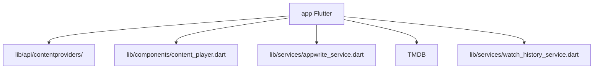

# kodify-js/MovieDex

> Flutter app for streaming movies and series, with an account, a watchlist and cloud sync.

## The problem
Watching movies and series on mobile or desktop from a free app rather than a closed service.

## What it actually does
A Flutter app with search, dark theme, watchlist, history, multiple video qualities and proxy. Metadata comes from TMDB, authentication and the database from Appwrite, with a Mixpanel token for usage measurement. Stream sources are content providers in `lib/api/contentproviders/`. The README states that the developers have no connection to the content.

## How it is wired
Simplified diagram based on the sheet, no diagram provided.


## Trying it
```bash
git clone https://github.com/kodify-js/MovieDex.git
cd MovieDex
flutter pub get
flutter pub run build_runner build
flutter run
```

## Cost and gotchas
A TMDB API key, an Appwrite project and a Mixpanel token to create in `lib/api/secrets.dart`. The content comes from third-party sources whose legal status is not addressed.

## What it is not
Not a standalone player: nothing works without the keys and the backend.

## Alternatives
No alternative named in the README.

## For you
Ignore: a streaming app for content of dubious origin, unrelated to data or AI work.
