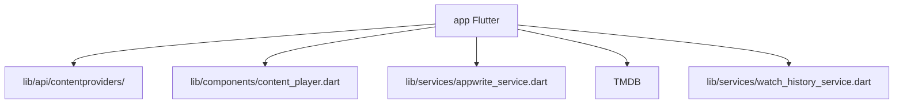

# kodify-js/MovieDex

> Application Flutter de streaming de films et séries, avec compte, liste de suivi et synchronisation cloud.

## Le problème
Regarder des films et séries sur mobile ou bureau depuis une application libre plutôt qu'un service fermé.

## Ce que ça fait vraiment
Application Flutter avec recherche, thème sombre, liste de suivi, historique, qualité vidéo multiple et proxy. Les métadonnées viennent de TMDB, l'authentification et la base d'Appwrite, avec un jeton Mixpanel pour la mesure d'usage. Les sources de flux sont des fournisseurs de contenu dans `lib/api/contentproviders/`. Le README précise que les développeurs n'ont aucun lien avec les contenus.

## Comment c'est branché
Schéma simplifié d'après la fiche, sans diagramme fourni.


## Essayer
```bash
git clone https://github.com/kodify-js/MovieDex.git
cd MovieDex
flutter pub get
flutter pub run build_runner build
flutter run
```

## Coût et pièges
Clé d'API TMDB, projet Appwrite et jeton Mixpanel à créer dans `lib/api/secrets.dart`. Les contenus viennent de sources tierces dont le statut juridique n'est pas traité.

## Ce que ce n'est pas
Pas un lecteur autonome : rien ne marche sans les clés et le backend.

## Alternatives
Aucune alternative nommée dans le README.

## Pour toi
À ignorer : application de streaming de contenus de provenance douteuse, sans lien avec un travail data ou IA.

