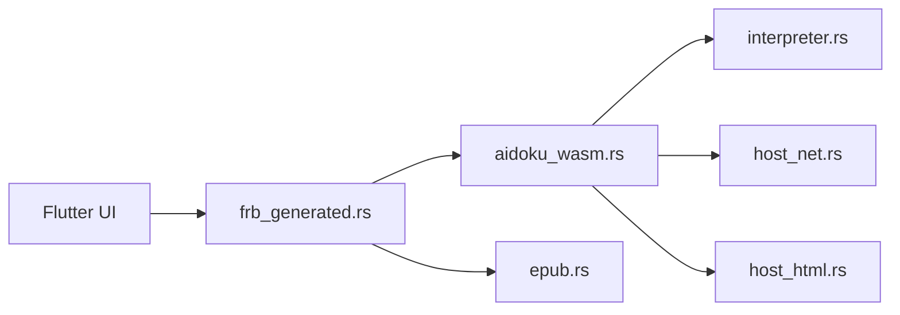

# kodjodevf/mangayomi

> Open source cross-platform Flutter app for reading manga and novels or watching anime.

## The problem
Reading manga, webtoons and anime from several sources requires several apps, each with its own library and tracking.

## What it actually does
A configurable reader (several reading modes), a library with categories, tracking via MyAnimeList / AniList / SIMKL / trakt / Kitsu, and local or cloud backups. Sources are loaded by a native Aidoku (WASM) engine written in Rust. The provided tree does not contain the Dart sources: the UI is not mapped.

## How it is wired


## Trying it
```bash
rustc --version
flutter doctor
cargo install 'flutter_rust_bridge_codegen'
flutter_rust_bridge_codegen generate
flutter run
```

## Cost and gotchas
Free. Building requires Flutter and Rust. The README warns that there is no official website: only the GitHub releases are safe. Content is supplied by third-party sources, not hosted by the project.

## What it is not
Not a content host: the author says he has no ties to the providers. Not a data/AI tool. Signed iOS builds only apply to versions > 0.5.2.

## Alternatives
No alternative named in the README.

## For you
Ignore: a consumer reading app unrelated to data, AI or MLOps; the only technical curiosity is the Aidoku WASM engine in Rust.
