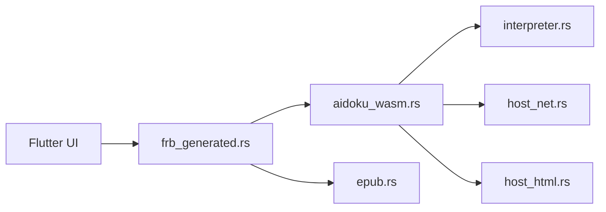

# kodjodevf/mangayomi

> Application Flutter open source pour lire manga et romans ou regarder des animes, multiplateforme.

## Le problème
Lire manga, webtoons et animes depuis plusieurs sources demande plusieurs applications, chacune avec sa bibliothèque et son suivi.

## Ce que ça fait vraiment
Un lecteur configurable (plusieurs modes de lecture), une bibliothèque par catégories, un suivi MyAnimeList / AniList / SIMKL / trakt / Kitsu, des sauvegardes locales ou cloud. Les sources sont chargées par un moteur natif Aidoku (WASM) en Rust. L'arbre fourni ne contient pas les sources Dart : l'UI n'est pas cartographiée.

## Comment c'est branché


## Essayer
```bash
rustc --version
flutter doctor
cargo install 'flutter_rust_bridge_codegen'
flutter_rust_bridge_codegen generate
flutter run
```

## Coût et pièges
Gratuit. Compiler demande Flutter et Rust. Le README prévient qu'il n'existe aucun site officiel : seules les releases GitHub sont sûres. Contenu fourni par des sources tierces, non hébergé par le projet.

## Ce que ce n'est pas
Pas un hébergeur de contenu : l'auteur se dit sans lien avec les fournisseurs. Pas un outil data/IA. Les iOS signés ne concernent que les versions > 0.5.2.

## Alternatives
Aucune alternative nommée dans le README.

## Pour toi
Ignorer : app grand public de lecture sans rapport avec data, IA ou MLOps ; seule curiosité technique, le moteur WASM Aidoku en Rust.

