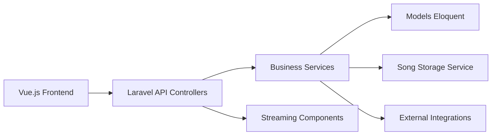

# koel/koel

> Self-hosted music streaming server, built with Laravel and Vue, for your personal collection.

## The problem
Listening to your own music library in a browser with playlists, scrobbling and podcasts.

## What it actually does
Scans the library and serves it through a Vue interface: playlists and smart playlists, Last.fm scrobbling, podcasts, radio, Spotify/MusicBrainz integrations, and a natural-language AI assistant. Local or cloud storage. Official mobile app Koel Player. The paid Koel Plus edition adds multi-user, SSO, themes, white-labeling.

## How it is wired

## Trying it
The README contains no command: it points to the official installation guide and the development guide.

## Cost and gotchas
Free open source (MIT); Koel Plus is paid. PHP/Laravel and a database to host. The AI assistant probably relies on an external provider: not detailed in the README.

## What it is not
Not an online music service: it contains no catalog.

## Alternatives
No alternative named in the README.

## For you
Hobby project unrelated to data/AI: ignore.
