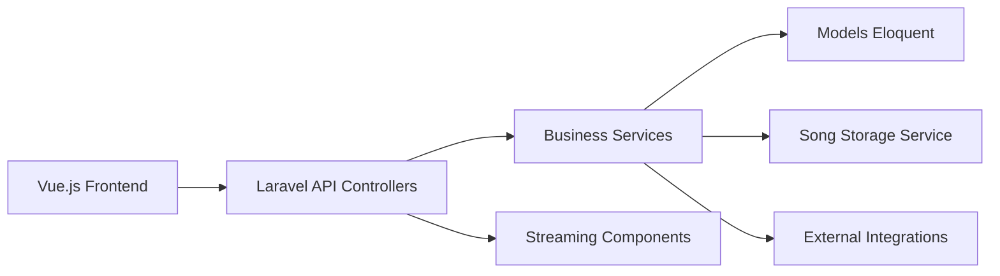

# koel/koel

> Serveur de streaming musical auto-hébergé, en Laravel et Vue, pour sa collection personnelle.

## Le problème
Écouter sa propre bibliothèque musicale dans un navigateur avec playlists, scrobbling et podcasts.

## Ce que ça fait vraiment
Parcourt la bibliothèque, la sert via une interface Vue : playlists et playlists intelligentes, scrobbling Last.fm, podcasts, radio, intégrations Spotify/MusicBrainz, et un assistant IA en langage naturel. Stockage local ou cloud. Application mobile officielle Koel Player. L'édition payante Koel Plus ajoute multi-utilisateurs, SSO, thèmes, marque blanche.

## Comment c'est branché

## Essayer
Le README ne contient aucune commande : il renvoie au guide d'installation officiel et au guide de développement.

## Coût et pièges
Open source gratuit (MIT) ; Koel Plus payant. PHP/Laravel et base de données à héberger. L'assistant IA suppose probablement un fournisseur externe : non détaillé dans le README.

## Ce que ce n'est pas
Pas un service musical en ligne : il ne contient pas de catalogue.

## Alternatives
Aucune alternative nommée dans le README.

## Pour toi
Projet de loisir sans rapport avec la data/IA : à ignorer.

