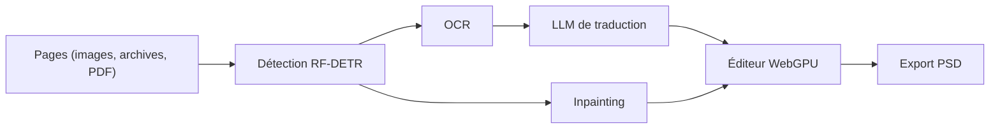

# koharu-rs/koharu

> A local manga translation app that chains detection, OCR, inpainting and an LLM, for translators and scanlators.

## The problem
Translating a manga means spotting the text, reading it, erasing it, translating, then recomposing the page by hand.

## What it actually does
It runs locally text-region detection, OCR (PaddleOCR VL, Manga OCR), inpainting erasure (FLUX.2 Klein, LaMa), then translation by a local (GGUF) or remote LLM (OpenAI, Gemini, Claude, DeepL). A WebGPU editor allows retouching, with layered PSD export.

## How it is wired
Simplified diagram based on the sheet, no diagram supplied.


## Trying it
```bash
winget install koharu
brew install --cask koharu
bun install
bun dev
```

## Cost and gotchas
Free locally, but a GPU (CUDA, ROCm, Metal or Vulkan) is recommended: the CPU is very slow. Remote providers require an API key at your expense. Models are downloaded separately.

## What it is not
Not a simple OCR: it is a complete chain. The "uncensored" models listed are your choice and your responsibility.

## Alternatives
No alternative named in the README.

## For you
Watch: a showcase of an end-to-end vision and local LLM pipeline, instructive to look at even if the manga case does not concern you.
