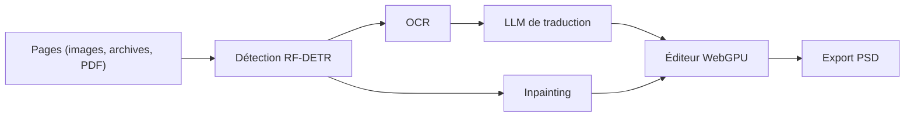

# koharu-rs/koharu

> Une application locale de traduction de mangas qui enchaîne détection, OCR, inpainting et LLM, pour traducteurs et scanlateurs.

## Le problème
Traduire un manga oblige à repérer le texte, le lire, l'effacer, traduire puis recomposer la page à la main.

## Ce que ça fait vraiment
Elle exécute en local la détection des zones de texte, l'OCR (PaddleOCR VL, Manga OCR), l'effacement par inpainting (FLUX.2 Klein, LaMa), puis la traduction par un LLM local (GGUF) ou distant (OpenAI, Gemini, Claude, DeepL). Un éditeur WebGPU permet la retouche, avec export PSD par calques.

## Comment c'est branché
Schéma simplifié d'après la fiche, sans diagramme fourni.


## Essayer
```bash
winget install koharu
brew install --cask koharu
bun install
bun dev
```

## Coût et pièges
Gratuit en local, mais un GPU (CUDA, ROCm, Metal ou Vulkan) est conseillé : le CPU est très lent. Les fournisseurs distants demandent une clé d'API à ta charge. Les modèles sont téléchargés séparément.

## Ce que ce n'est pas
Pas un simple OCR : c'est une chaîne complète. Les modèles « uncensored » listés relèvent de ton choix et de ta responsabilité.

## Alternatives
Aucune alternative nommée dans le README.

## Pour toi
À surveiller : vitrine d'un pipeline vision et LLM local de bout en bout, instructive à regarder même si le cas manga ne te concerne pas.

