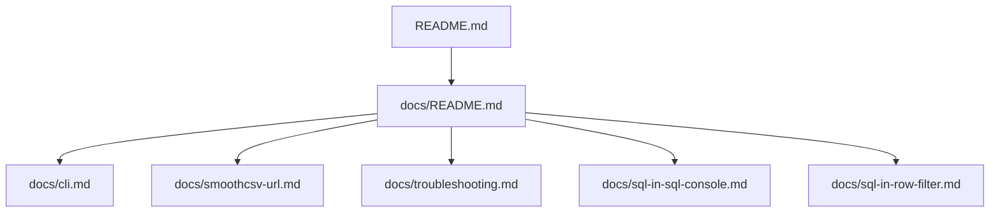

# kohii/smoothcsv3

> Cross-platform CSV editor with a spreadsheet grid, SQL console and file comparison.

## The problem
Opening large, messy CSVs in a spreadsheet breaks formats, and text editors lack tabular tools.

## What it actually does
An editing grid with regex search, SQL filters, sorting, multi-cell editing, a SQL console for SELECT queries, comparison of two CSVs, Excel import and export, PDF export, customizable file formats, an interface in eleven languages, command line and `smoothcsv://` links. This repository contains only the documentation and issue tracking, not the code.

## How it is wired

## Trying it
No command: download the latest version from the releases page.

## Cost and gotchas
Free to use, but no declared license and the code is not published here. Parquet, Avro and JSON formats are only planned.

## What it is not
Not a verifiable open-source tool: the repository serves for tracking and releases. No schema or validation yet.

## Alternatives
No alternative named in the README.

## For you
Worth watching: handy for cleaning and querying CSVs locally, but effectively closed source and unlicensed.
