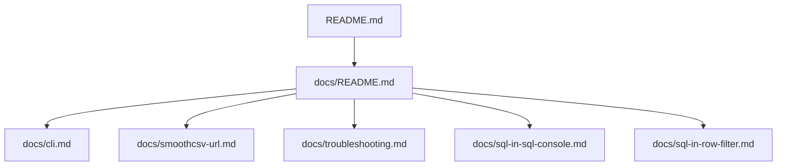

# kohii/smoothcsv3

> Éditeur CSV multiplateforme avec grille de tableur, console SQL et comparaison de fichiers.

## Le problème
Ouvrir de gros CSV désordonnés dans un tableur casse les formats, et les éditeurs texte manquent d'outils tabulaires.

## Ce que ça fait vraiment
Une grille d'édition avec recherche regex, filtres SQL, tris, édition multi-cellules, console SQL pour requêtes SELECT, comparaison de deux CSV, import et export Excel, export PDF, formats de fichier personnalisables, interface en onze langues, ligne de commande et liens `smoothcsv://`. Ce dépôt ne contient que la documentation et le suivi des tickets, pas le code.

## Comment c'est branché

## Essayer
Aucune commande : télécharger la dernière version depuis la page des releases.

## Coût et pièges
Gratuit à l'usage, mais aucune licence déclarée et code non publié ici. Les formats Parquet, Avro et JSON sont seulement prévus.

## Ce que ce n'est pas
Pas un outil open source vérifiable : le dépôt sert au suivi et aux releases. Pas encore de schéma ni de validation.

## Alternatives
Aucune alternative nommée dans le README.

## Pour toi
Surveiller : pratique pour nettoyer et requêter des CSV en local, mais code fermé de fait et sans licence.

