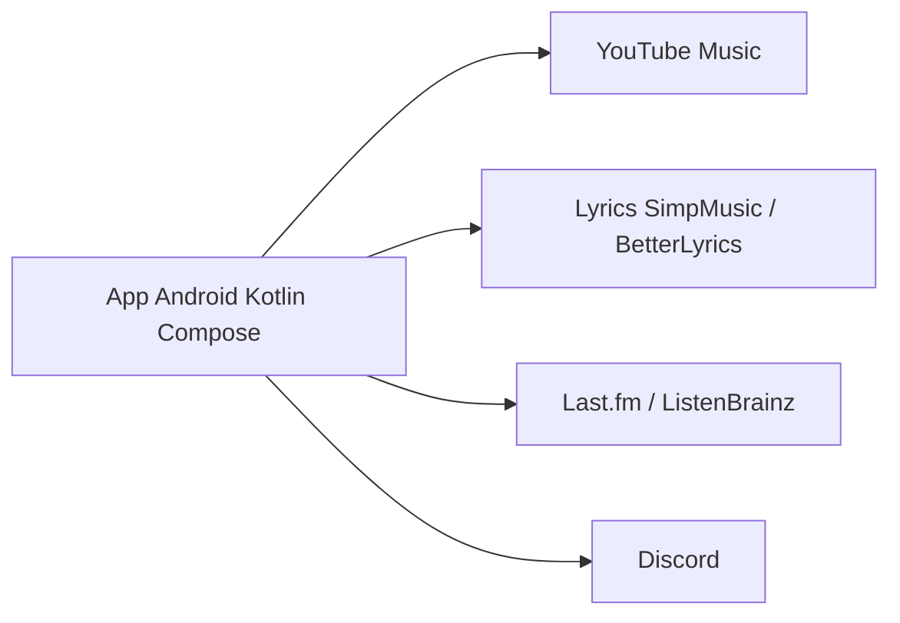

# koiverse/ArchiveTune

> Android client for YouTube Music in Kotlin and Jetpack Compose, for ad-free listening with advanced options.

## The problem
The official app imposes ads, limited settings and little customization. This client offers a local alternative.

## What it actually does
Playback with multiple accounts, local files and playlists, EBU R128 normalization, crossfade, equalizer, synced lyrics with translation, Last.fm and ListenBrainz scrobbling, Discord presence, Spotify import. Material 3 interface. It builds on Metrolist and other credited projects.

## How it is wired


## Trying it
```bash
# Aucune commande : installer l'APK depuis GitHub Releases,
# Obtainium ou IzzyOnDroid (liens du README).
```

## Cost and gotchas
Free. A region not supported by YouTube Music requires a VPN or proxy. Forks are not supported. It depends on YouTube Music, and therefore on its changes.

## What it is not
Not affiliated with Google or YouTube. Not a development or data tool.

## Alternatives
- Metrolist: the project's base, credited in the README.
- SimpMusic: neighboring project credited for the lyrics API.

## For you
Ignore: a consumer Android app with no link to data/AI/MLOps work.
