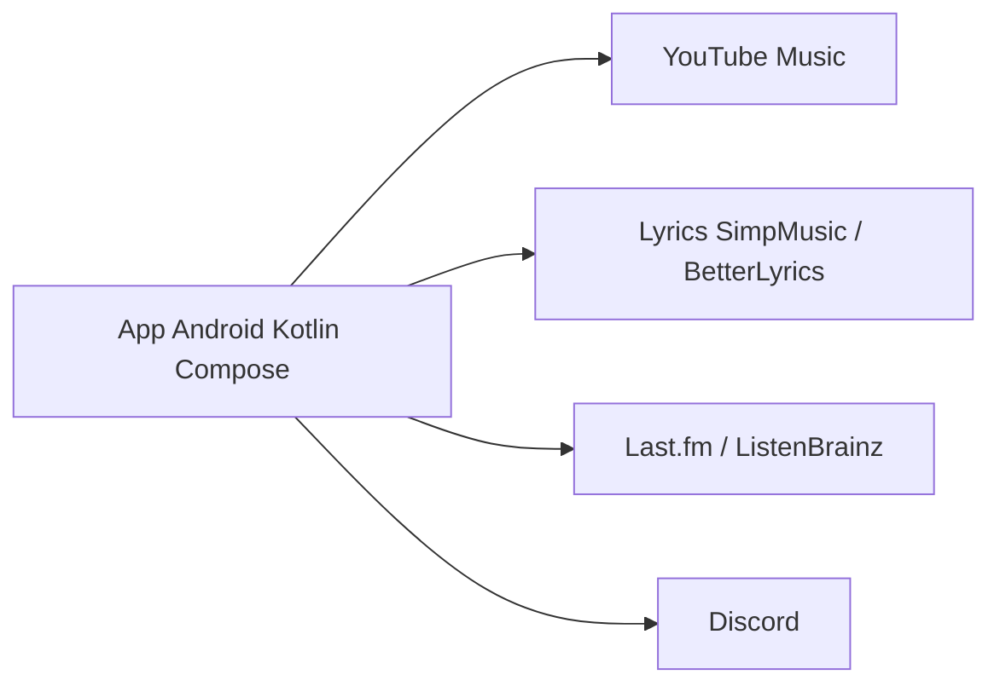

# koiverse/ArchiveTune

> Client Android de YouTube Music en Kotlin et Jetpack Compose, pour écouter sans publicité avec options poussées.

## Le problème
L'application officielle impose publicités, réglages limités et peu de personnalisation. Ce client propose une alternative locale.

## Ce que ça fait vraiment
Lecture avec comptes multiples, local et playlists, normalisation EBU R128, crossfade, égaliseur, paroles synchronisées avec traduction, scrobbling Last.fm et ListenBrainz, présence Discord, import Spotify. Interface Material 3. Il s'appuie sur Metrolist et d'autres projets cités.

## Comment c'est branché


## Essayer
```bash
# Aucune commande : installer l'APK depuis GitHub Releases,
# Obtainium ou IzzyOnDroid (liens du README).
```

## Coût et pièges
Gratuit. Une région non supportée par YouTube Music exige un VPN ou proxy. Les forks ne sont pas supportés. Dépend de YouTube Music, donc de ses changements.

## Ce que ce n'est pas
Pas affilié à Google ni YouTube. Pas un outil de développement ni de data.

## Alternatives
- Metrolist : base du projet, citée dans le README.
- SimpMusic : projet voisin cité pour l'API de paroles.

## Pour toi
Ignorer : application grand public Android sans lien avec le travail data/IA/MLOps.

