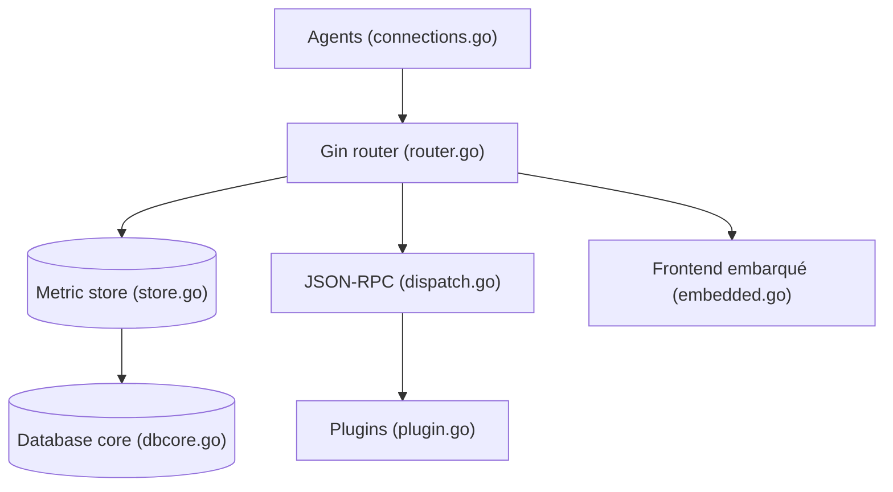

# komari-monitor/komari

> Lightweight self-hosted server monitoring with an agent and a web interface, for system administrators.

## The problem
Keeping track of the state of a few servers without deploying a heavy monitoring stack.

## What it actually does
A Go server receives metrics sent by lightweight agents, stores them (SQLite, with a PostgreSQL abstraction for metrics) and displays them in real time (a one-second interval is advertised). It also offers a web terminal, file transfer via the agent, notifications (e-mail, Telegram, webhook), themes and JavaScript plugins.

## How it is wired

## Trying it
No command is documented in the README: it points to the installation guide (Docker, binary, build from source).

## Cost and gotchas
Free. The agent gives the server remote control (terminal, files): a compromised server opens access to every supervised machine. The README warns to deploy only on authorized systems. It also contains advertising banners for hosting providers.

## What it is not
Not a model or pipeline observability tool, nor a replacement for a full Prometheus stack. It is not just a passive dashboard: it runs commands.

## Alternatives
No alternative is cited in the README.

## For you
Ignore it for your data / AI / MLOps profile: it is personal server monitoring, unrelated to model metrics, and the remote-control agent widens the attack surface.
