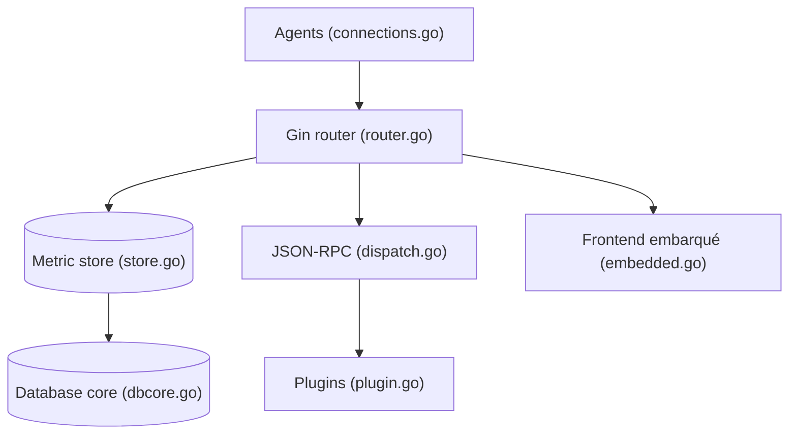

# komari-monitor/komari

> Supervision de serveurs auto-hébergée, légère, avec agent et interface web, pour administrateurs système.

## Le problème
Suivre l'état de quelques serveurs sans déployer une pile de supervision lourde.

## Ce que ça fait vraiment
Un serveur Go reçoit les métriques envoyées par des agents légers, les stocke (SQLite, avec abstraction PostgreSQL pour les métriques) et les affiche en temps réel (intervalle d'une seconde annoncé). Il offre aussi un terminal web, un transfert de fichiers via l'agent, des notifications (e-mail, Telegram, webhook), des thèmes et des plugins JavaScript.

## Comment c'est branché

## Essayer
Aucune commande documentée dans le README : il renvoie au guide d'installation (Docker, binaire, compilation).

## Coût et pièges
Gratuit. L'agent donne au serveur un contrôle à distance (terminal, fichiers) : un serveur compromis ouvre l'accès à toutes les machines supervisées. Le README prévient de ne déployer que sur des systèmes autorisés. Il contient aussi des encarts publicitaires pour des hébergeurs.

## Ce que ce n'est pas
Pas un outil d'observabilité de modèles ou de pipelines, ni un remplaçant d'une pile Prometheus complète. Ce n'est pas qu'un tableau de bord passif : il exécute des commandes.

## Alternatives
Aucune alternative citée dans le README.

## Pour toi
À ignorer pour ton profil data / IA / MLOps : c'est de la supervision de serveurs personnels, sans lien avec les métriques de modèles, et l'agent à contrôle distant élargit la surface d'attaque.

