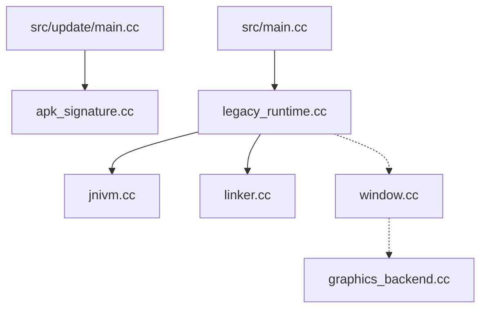

# komaruworld/mocktail

> Compatibility layer that runs Roblox's Android client on Linux, with SDL3 and Vulkan or OpenGL.

## The problem
Roblox has no official Linux client; the missing platform has to be worked around.

## What it actually does
Downloads the APK on first launch, checks signature and ABI, provides Bionic and JNI, then links the client to SDL3 and the Linux graphics stack. x86_64 supported; aarch64 and FreeBSD (Linuxulator) experimental. Settings via `fflags.json`. An independent project, unrelated to Roblox, which does not distribute the client.

## How it is wired


## Trying it
```bash
flatpak install flathub space.bigrat.mocktail
flatpak run space.bigrat.mocktail
# source :
git clone --recurse-submodules https://github.com/komaruworld/mocktail.git
cd mocktail && make build && ./build/mocktail
```

## Cost and gotchas
GPU with Vulkan, many build dependencies. Does not work with `hardened_malloc`. Depends on the APK and Roblox services, with 61 open issues.

## What it is not
Not a full Android emulator: a specialised runner for a single client.

## Alternatives
No alternative named in the README.

## For you
Ignore: used to play Roblox on Linux, nothing to do with data or AI.
