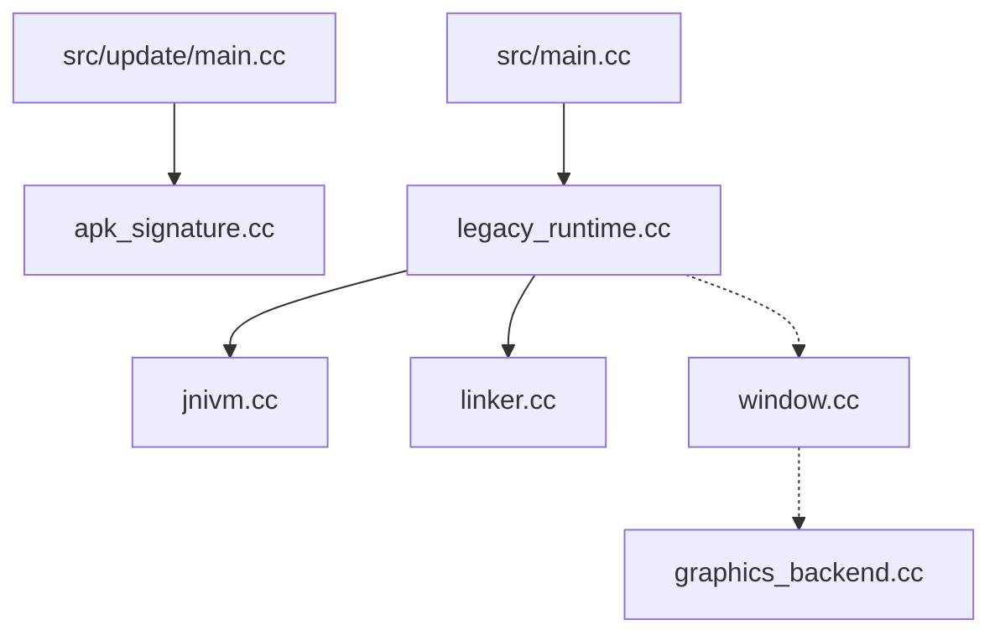

# komaruworld/mocktail

> Couche de compatibilité qui exécute le client Android de Roblox sous Linux, avec SDL3 et Vulkan ou OpenGL.

## Le problème
Roblox n'a pas de client Linux officiel ; il faut contourner l'absence de plateforme.

## Ce que ça fait vraiment
Télécharge l'APK au premier lancement, vérifie signature et ABI, fournit Bionic et JNI, puis relie le client à SDL3 et à la pile graphique Linux. x86_64 pris en charge ; aarch64 et FreeBSD (Linuxulator) expérimentaux. Réglages via `fflags.json`. Projet indépendant, sans lien avec Roblox, qui ne distribue pas le client.

## Comment c'est branché


## Essayer
```bash
flatpak install flathub space.bigrat.mocktail
flatpak run space.bigrat.mocktail
# source :
git clone --recurse-submodules https://github.com/komaruworld/mocktail.git
cd mocktail && make build && ./build/mocktail
```

## Coût et pièges
GPU avec Vulkan, nombreuses dépendances de compilation. Ne fonctionne pas avec `hardened_malloc`. Dépend de l'APK et des services Roblox, avec 61 issues ouvertes.

## Ce que ce n'est pas
Pas un émulateur Android complet : un exécuteur spécialisé pour un seul client.

## Alternatives
Aucune alternative nommée dans le README.

## Pour toi
Ignorer : sert à jouer à Roblox sous Linux, aucun rapport avec la data ou l'IA.

