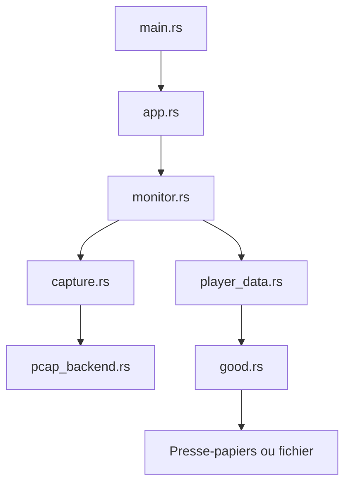

# konkers/irminsul

> Extracts the Genshin Impact inventory through packet capture and exports it to Genshin Optimizer.

## The problem
Inventory scanners based on optical character recognition are slow.

## What it actually does
Desktop application in Rust: it captures the game's UDP packets, decodes characters, weapons, materials and artifacts, then exports them in the GOOD format to the clipboard or a file. Two capture engines: pktmon (Windows) and pcap. It also updates itself.

## How it is wired

## Trying it
No command documented in the README: the `--capture-backend` and `--no-admin` options are mentioned.

## Cost and gotchas
Free. Administrator or root rights are needed for capture, and it must be launched when the game starts to see the connection. Libpcap is required if you build it yourself on Linux.

## What it is not
Not a cheating tool: it reads the player's traffic without modifying the game. Export of wishes and achievements is still planned.

## Alternatives
No alternative named in the README, which only mentions OCR scanners.

## For you
Ignore: a gaming utility, with no use in data, AI or MLOps work.
