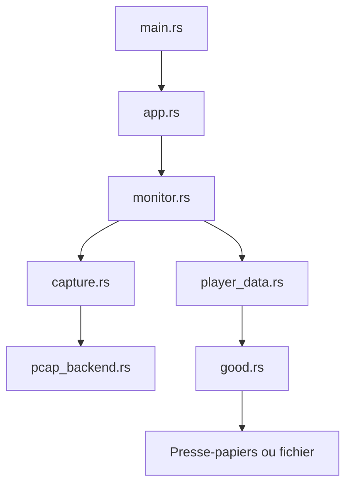

# konkers/irminsul

> Extrait l'inventaire de Genshin Impact par capture de paquets et l'exporte vers Genshin Optimizer.

## Le problème
Les scanners d'inventaire par reconnaissance optique de caractères sont lents.

## Ce que ça fait vraiment
Application de bureau en Rust : elle capture les paquets UDP du jeu, décode personnages, armes, matériaux et artefacts, puis exporte au format GOOD vers le presse-papiers ou un fichier. Deux moteurs de capture : pktmon (Windows) et pcap. Elle se met aussi à jour seule.

## Comment c'est branché

## Essayer
Aucune commande documentée dans le README : l'option `--capture-backend` et `--no-admin` sont citées.

## Coût et pièges
Gratuit. Droits administrateur ou root pour la capture, et lancement au démarrage du jeu pour voir la connexion. Libpcap requise si compilé soi-même sous Linux.

## Ce que ce n'est pas
Pas un outil de triche : il lit le trafic du joueur, sans modifier la partie. Export des vœux et des succès encore prévu.

## Alternatives
Aucune alternative nommée dans le README, qui cite seulement les scanners par OCR.

## Pour toi
À ignorer : un utilitaire de jeu, sans usage dans un travail data, IA ou MLOps.

