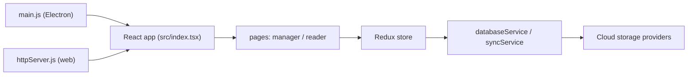

# koodo-reader/koodo-reader

> Cross-platform e-book reader, with cloud sync, notes and optional AI tools.

## The problem
Reading EPUB, PDF, MOBI or comics across several devices with synced notes and progress often requires several applications or a proprietary account.

## What it actually does
React/TypeScript application packaged in Electron (Windows, macOS, Linux), web, Android, iOS and Docker. Books and notes are stored locally, then can be synced to OneDrive, Google Drive, Dropbox, WebDAV, S3 and others. OCR (Tesseract/Paddle) and archive reading run client-side. AI (translation, dictionary, summary) uses your own model; the README promises no tracking.

## How it is wired


## Trying it
```bash
winget install AppByTroye.KoodoReader
flatpak install flathub io.github.troyeguo.koodo-reader
brew install --cask koodo-reader
git clone https://github.com/koodo-reader/koodo-reader.git && cd koodo-reader && yarn && yarn dev
```

## Cost and gotchas
Free. Third-party sync services have their own accounts and quotas. 271 open issues. AGPL-3.0 license: obligations if you provide a modified version as a service.

## What it is not
It is not an embeddable reading library; it is an application. AI is not provided: you must plug in your own model.

## Alternatives
- No alternative named in the README (KOReader is only cited as a sync target).

## For you
Watch: handy for reading PDF papers and exporting highlights to Obsidian or Notion, unrelated to development.
