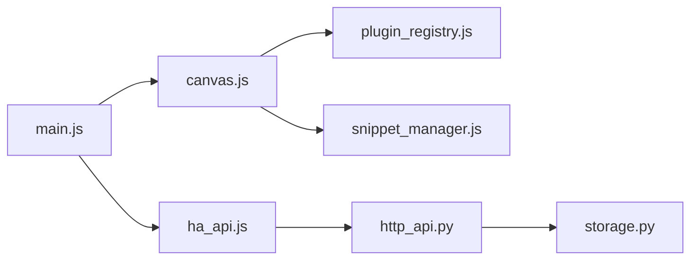

# koosoli/ESPHomeDesigner

> Visual drag-and-drop editor for ESPHome, OpenEpaperLink and OpenDisplay connected displays, integrated into Home Assistant.

## The problem
Hand-writing the lambda or LVGL code for an ESP32 or e-paper screen is slow and hard to preview.

## What it actually does
Multi-page canvas with more than 55 widgets (text, graphs, weather, QR, touch zones) bound to Home Assistant entities or MQTT topics. Generates ESPHome YAML (C++ or LVGL), OpenEpaperLink or OpenDisplay JSON, and re-imports YAML for round-trip editing. AI assistant (Gemini, OpenAI, OpenRouter) to generate layouts. LVGL mode is flagged as unstable.

## How it is wired


## Trying it
```bash
npm install
npm run dev
npm test
npm run python:test
npm run quality
```

## Cost and gotchas
Free; the AI assistant uses your provider key. You need a Home Assistant, a long-lived token and a CORS configuration. LVGL requires an ESP32-S3 with PSRAM. The generated YAML must be pasted by hand into your ESPHome config.

## What it is not
Not a flasher or a replacement for ESPHome: it produces a YAML snippet. Highly customized `lambda:` code may not rebuild correctly on import.

## Alternatives
No alternative named in the README.

## For you
Ignore: home automation and embedded displays, far from the data/AI/MLOps scope; GPL-3.0 and a single maintainer.
