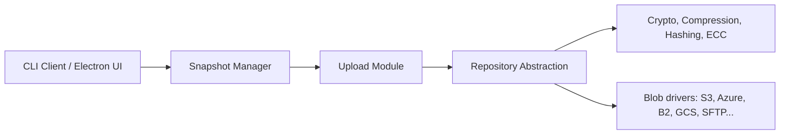

# kopia/kopia

> Encrypted, deduplicated backup tool, with CLI and GUI, to the storage of your choice.

## The problem
Backing up important folders to a cloud or a NAS without handing over your data in clear text or paying for duplicates.

## What it actually does
Creates encrypted, compressed and deduplicated snapshots of files and folders (no disk image). The Go engine is driven by a CLI, an Electron UI or a gRPC/HTTP repository server. Storage: S3 and compatibles, Azure, B2, GCS, WebDAV, SFTP, Rclone (experimental), local disk. Notifications by e-mail, webhook, Pushover.

## How it is wired

## Trying it
The README gives no command: it points to the installation page and the "Getting Started Guide" on the website.

## Cost and gotchas
Free software; the cloud storage you choose remains at your expense. Rclone is experimental. 883 open issues.

## What it is not
Not a whole-machine backup: it does not make system images.

## Alternatives
No alternative cited in the README.

## For you
Adopt: encrypted and deduplicated backup of datasets or experiments to S3/B2, under Apache-2.0 and actively developed.
