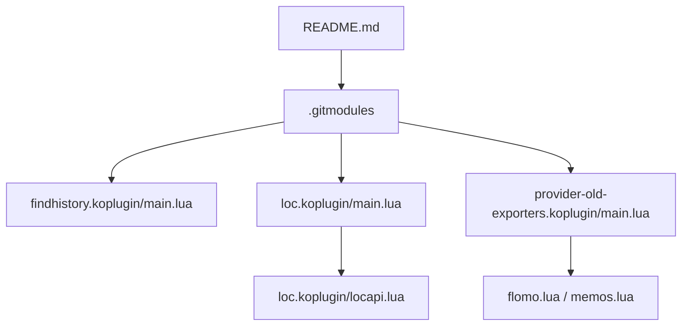

# koreader/contrib

> Collection of uncommon KOReader plugins, declared as git submodules.

## The problem
Plugins useful to a minority do not belong in KOReader's main code.

## What it actually does
Each plugin is a submodule (`.gitmodules`) pointing to an upstream repository: `findhistory`, `loc`, `provider-old-exporters` (flomo, memos), `readwisereader`. The README warns that they may stop working after a KOReader update.

## How it is wired


## Trying it
```bash
# Aucune commande documentée dans le README.
```

## Cost and gotchas
Free, but each plugin has its own license and its own state; AGPL-3.0 license for the repository. If something breaks after an update, report it on the upstream repository.

## What it is not
Not a guaranteed catalog: no compatibility is promised with all KOReader versions.

## Alternatives
No alternative named in the README.

## For you
Ignore: extensions for e-readers, outside the data / AI / MLOps scope.
