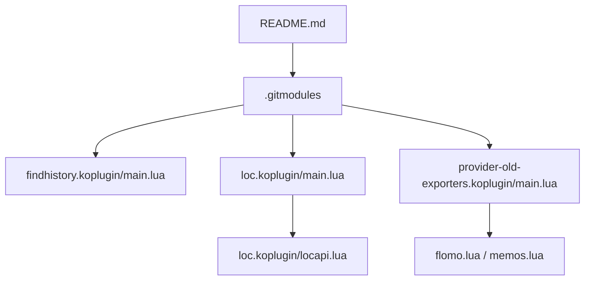

# koreader/contrib

> Recueil de plugins KOReader peu courants, déclarés en sous-modules git.

## Le problème
Des plugins utiles à une minorité n'ont pas leur place dans le code principal de KOReader.

## Ce que ça fait vraiment
Chaque plugin est un sous-module (`.gitmodules`) pointant vers un dépôt amont : `findhistory`, `loc`, `provider-old-exporters` (flomo, memos), `readwisereader`. Le README prévient qu'ils peuvent cesser de fonctionner après une mise à jour de KOReader.

## Comment c'est branché


## Essayer
```bash
# Aucune commande documentée dans le README.
```

## Coût et pièges
Gratuit, mais chaque plugin a sa propre licence et son propre état ; licence AGPL-3.0 pour le dépôt. En cas de panne après mise à jour, signaler sur le dépôt amont.

## Ce que ce n'est pas
Pas un catalogue garanti : aucune compatibilité promise avec toutes les versions de KOReader.

## Alternatives
Aucune alternative nommée dans le README.

## Pour toi
Ignorer : extensions pour liseuse électronique, hors périmètre data / IA / MLOps.

