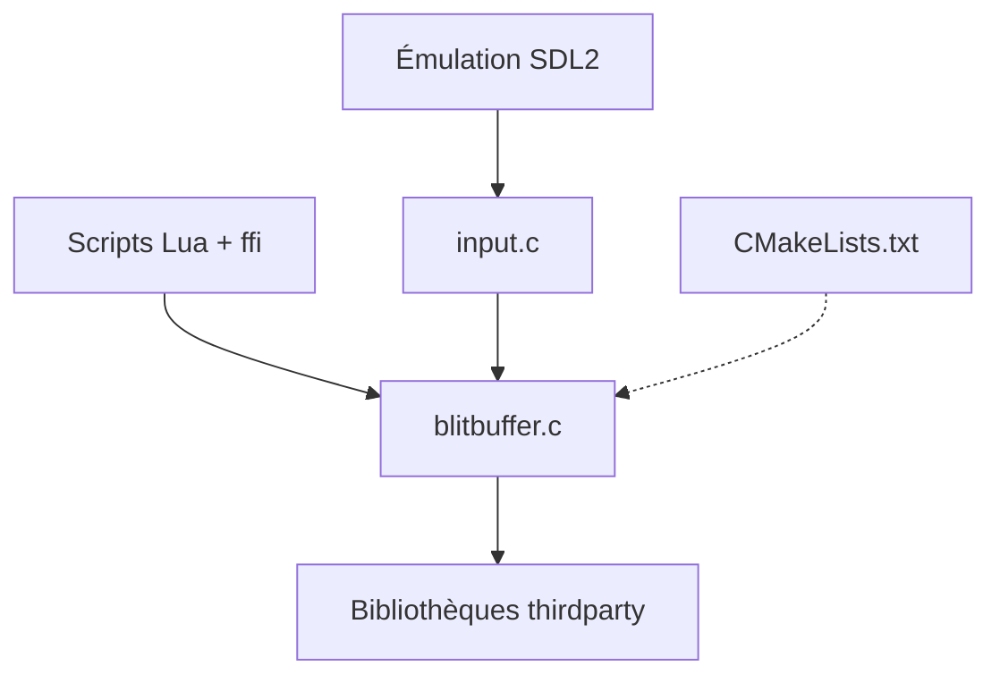

# koreader/koreader-base

> C and Lua foundation of KOReader, a document reader for e-ink e-readers.

## The problem
Reading PDF, DjVu and EPUB on many e-ink devices requires a portable rendering engine.

## What it actually does
Assembles MuPDF, djvulibre, CREngine and libk2pdfopt, driven in Lua through LuaJIT and FFI. Handles framebuffer and input per device (Kindle, Kobo, PocketBook, Android) and offers an SDL2 emulator for developing on a PC.

## How it is wired


## Trying it
```bash
make fetchthirdparty
make TARGET=kindlehf
make
```

## Cost and gotchas
Free. Long build needing patch, wget, unzip, git, svn; SDL2 for the emulator. AGPL-3.0.

## What it is not
Not the full KOReader application: only its base.

## Alternatives
No alternative named in the README.

## For you
Ignore: e-ink reader foundation, unrelated to data/AI; the AGPL also weighs on any reuse.
