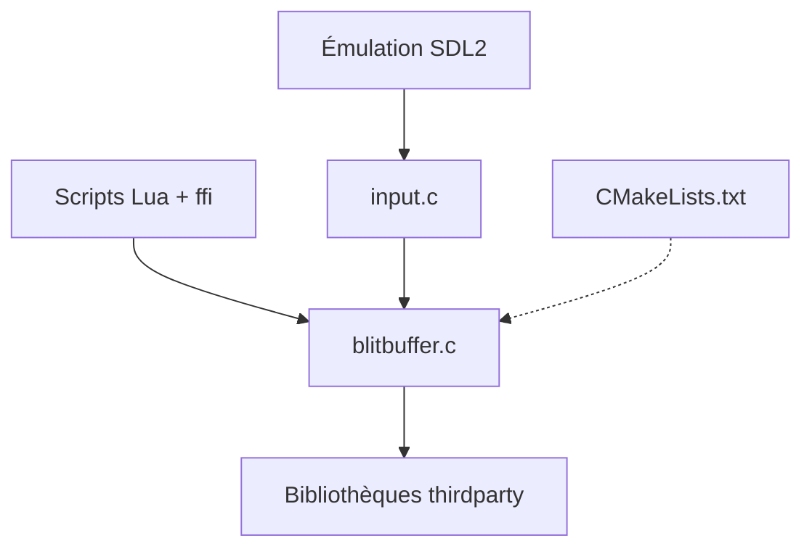

# koreader/koreader-base

> Socle C et Lua de KOReader, lecteur de documents pour liseuses e-ink.

## Le problème
Lire PDF, DjVu et EPUB sur de nombreux appareils e-ink demande un moteur de rendu portable.

## Ce que ça fait vraiment
Assemble MuPDF, djvulibre, CREngine et libk2pdfopt, pilotés en Lua via LuaJIT et FFI. Gère framebuffer et entrées par appareil (Kindle, Kobo, PocketBook, Android) et propose un émulateur SDL2 pour développer sur PC.

## Comment c'est branché


## Essayer
```bash
make fetchthirdparty
make TARGET=kindlehf
make
```

## Coût et pièges
Gratuit. Compilation longue avec patch, wget, unzip, git, svn ; SDL2 pour l'émulateur. AGPL-3.0.

## Ce que ce n'est pas
Pas l'application KOReader complète : seulement sa base.

## Alternatives
Aucune alternative nommée dans le README.

## Pour toi
À ignorer : socle de liseuse e-ink, sans lien avec data/IA ; l'AGPL pèse aussi sur tout réemploi.

