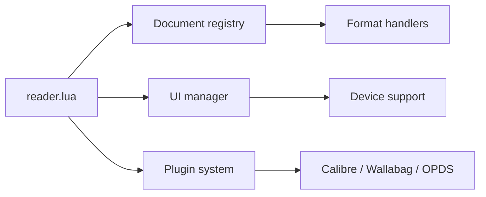

# koreader/koreader

> Document reader optimized for e-ink readers, also running on Android and Linux.

## The problem
The reading software built into e-readers handles formats, layout and fine settings poorly.

## What it actually does
Reads PDF, DjVu, CBZ, EPUB, FB2, Mobi, etc., with settings for margins, line spacing, fonts, multilingual hyphenation and reflow of scanned PDFs (K2pdfopt). Integrations: Calibre (OPDS, wireless send), Wallabag, Wikipedia, Google Translate, StarDict dictionaries, RSS feeds, FTP client, SSH server. Lua plugins. Targets: Kindle, Kobo, PocketBook, reMarkable, Cervantes, Android and Linux.

## How it is wired

## Trying it
No command in the README: installation links per device (Android, Kindle, Kobo, Linux, PocketBook, reMarkable).

## Cost and gotchas
Free. Installation specific to each device, sometimes with jailbreaking the e-reader (not detailed in the README). AGPL-3.0 license.

## What it is not
Not a bookstore nor a synchronization service: it plugs into Calibre or Wallabag.

## Alternatives
No alternative cited in the README.

## For you
Ignore for your line of work: reader for e-readers, useful only if you read papers and PDFs on e-ink.
