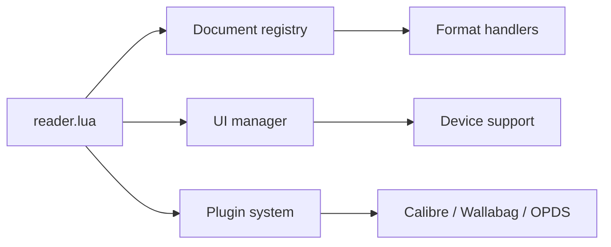

# koreader/koreader

> Lecteur de documents optimisé pour liseuses à encre électronique, tournant aussi sur Android et Linux.

## Le problème
Les logiciels de lecture intégrés aux liseuses gèrent mal les formats, la mise en page et les réglages fins.

## Ce que ça fait vraiment
Lit PDF, DjVu, CBZ, EPUB, FB2, Mobi, etc., avec réglages de marges, interlignes, polices, coupures de mots multilingues et reflow des PDF scannés (K2pdfopt). Intégrations : Calibre (OPDS, envoi sans fil), Wallabag, Wikipédia, Google Translate, dictionnaires StarDict, flux RSS, client FTP, serveur SSH. Plugins Lua. Cibles : Kindle, Kobo, PocketBook, reMarkable, Cervantes, Android et Linux.

## Comment c'est branché

## Essayer
Aucune commande dans le README : liens d'installation par appareil (Android, Kindle, Kobo, Linux, PocketBook, reMarkable).

## Coût et pièges
Gratuit. Installation spécifique à chaque appareil, parfois avec jailbreak de la liseuse (non détaillé dans le README). Licence AGPL-3.0.

## Ce que ce n'est pas
Pas un magasin de livres ni un service de synchronisation : il se branche sur Calibre ou Wallabag.

## Alternatives
Aucune alternative citée dans le README.

## Pour toi
À ignorer pour ton métier : lecteur pour liseuses, utile seulement si tu lis papers et PDF sur encre électronique.

