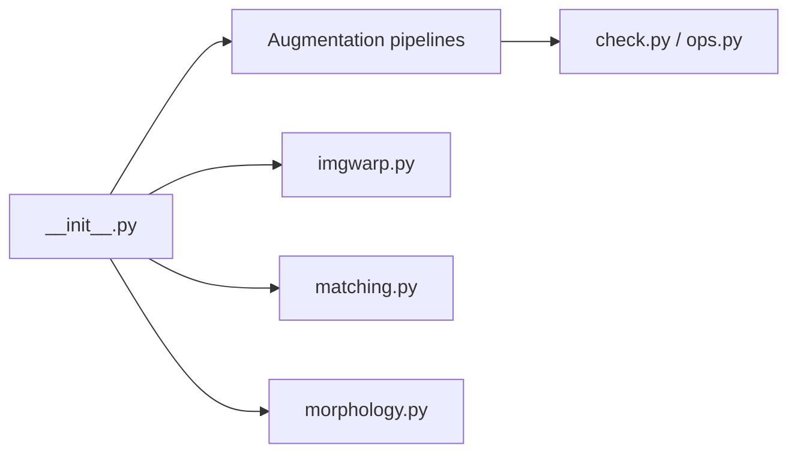

# kornia/kornia

> Differentiable computer vision library for PyTorch: filters, geometry, augmentations, models.

## The problem
Classic vision operators (OpenCV) do not plug into the gradient graph nor run batched on GPU.

## What it actually does
Over 500 differentiable operators: filters, transforms, color, morphology, augmentations (`AugmentationSequential`, AutoAugment), keypoint detection and matching (LoFTR, LightGlue, DISK), camera geometry and losses. ONNX export via `ONNXSequential`. The model zoo is frozen to extension; the announced direction is that of a reference implementation of geometry.

## How it is wired


## Trying it
```bash
pip install kornia
pip install git+https://github.com/kornia/kornia
pixi install
pixi run test
```

## Cost and gotchas
Free. Some functions (ONNX, Stable Diffusion dissolving) require extras. A GPU is useful, not mandatory.

## What it is not
Not a training framework: a tensor toolbox. No new model will be integrated without a maintainer sponsor.

## Alternatives
No alternative named in the README.

## For you
Adopt it if you do vision under PyTorch: GPU augmentations and geometry, Apache-2.0, recent activity.
