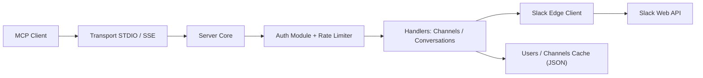

# korotovsky/slack-mcp-server

> Go MCP server giving an agent access to Slack messages, channels and groups.

## The problem
An agent can neither read Slack history nor search threads without a dedicated integration.

## What it actually does
Translates MCP calls into Slack API calls (edge client). Tools: history, thread replies, message search, channel list, unreads, user groups, "saved"; writing (message, reactions, mark as read) disabled by default. Authentication via browser token `xoxc/xoxd`, OAuth `xoxp` or bot `xoxb` (reduced features). Local JSON caches of users and channels; stdio and SSE transports.

## How it is wired


## Trying it
The provided README is truncated: the introduction and installation sections are missing. Only commands present:
```bash
npx @modelcontextprotocol/inspector go run mcp/mcp-server.go --transport stdio
tail -n 20 -f ~/Library/Logs/Claude/mcp*.log
```

## Cost and gotchas
Free, but it needs sensitive Slack tokens (the README says never to share them). Browser session tokens bypass the official application; free-plan history is limited to 90 days.

## What it is not
Not an official Slack bot: without the cache, `channels_list` does not work; bot tokens have no search.

## Alternatives
No alternative named in the README.

## For you
Worth watching: handy for giving an agent Slack context, but handling personal session tokens demands real care.
