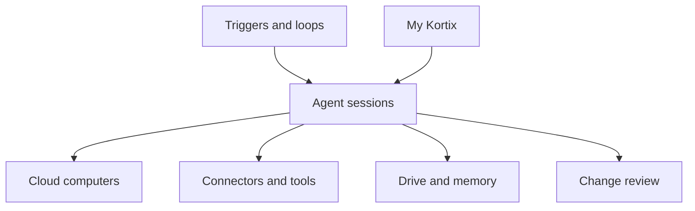

# kortix-ai/CompanyOS

> Open source platform of always-on, event-triggered agents, each on its own cloud computer.

## The problem
An agent session is tied to one human, one machine and a single context; it stops when the computer shuts down.

## What it actually does
You write agents on pi, deployed in the cloud. Triggers (schedules, webhooks, connector events) start sessions; "My Kortix" delegates, each session has its own machine that sleeps after 15 to 20 minutes. More than 3,000 connectable apps, memory Drive, human review of changes, SAML and SCIM.

## How it is wired


## Trying it
```bash
curl -fsSL https://kortix.com/install | bash
kortix init
kortix ship
kortix self-host start
```

## Cost and gotchas
Self-hosting via Docker Compose, but the images come from Docker Hub and the sandboxes run at Platinum by default. Models with your own keys. License not identified by GitHub; the white-label license requires Platinum as the compute provider.

## What it is not
Not a simple agent framework: it is a complete platform. Self-hosting is not disconnected.

## Alternatives
No alternative named in the README.

## For you
Watch: the idea of event-driven agents is solid, but the dependence on Platinum and the unclear license call for a legal reading before any use.
