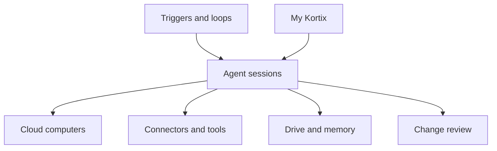

# kortix-ai/CompanyOS

> Plateforme open source d'agents toujours actifs, déclenchés par événements, chacun sur son ordinateur cloud.

## Le problème
Une session d'agent est liée à un humain, à une machine et à un seul contexte ; elle s'arrête quand l'ordinateur s'éteint.

## Ce que ça fait vraiment
Tu écris des agents sur pi, déployés dans le cloud. Des déclencheurs (planifications, webhooks, événements de connecteurs) démarrent des sessions ; « My Kortix » délègue, chaque session a sa machine qui dort après 15 à 20 minutes. Plus de 3 000 applications connectables, Drive de mémoire, revue des changements par une personne, SAML et SCIM.

## Comment c'est branché


## Essayer
```bash
curl -fsSL https://kortix.com/install | bash
kortix init
kortix ship
kortix self-host start
```

## Coût et pièges
Auto-hébergement par Docker Compose, mais les images viennent de Docker Hub et les bacs à sable tournent chez Platinum par défaut. Modèles avec tes clés. Licence non identifiée par GitHub ; la licence white-label impose Platinum comme fournisseur de calcul.

## Ce que ce n'est pas
Pas un simple framework d'agent : c'est une plateforme complète. L'auto-hébergement n'est pas déconnecté.

## Alternatives
Aucune alternative nommée dans le README.

## Pour toi
À surveiller : l'idée agents sur événements est solide, mais la dépendance à Platinum et la licence floue demandent une lecture juridique avant tout usage.

