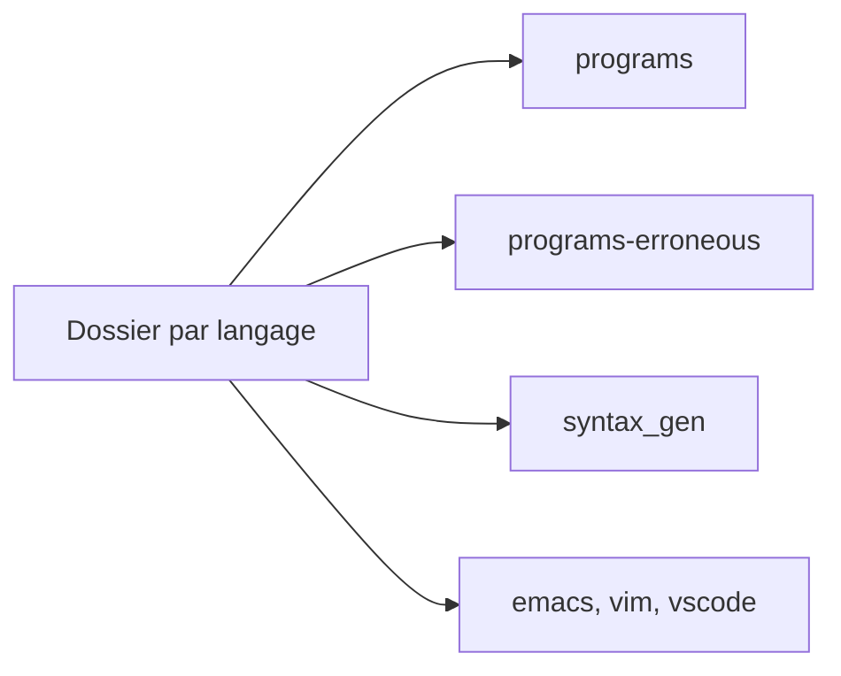

# kostis/ntua_compilers

> Sample programs and utilities for the compilers course at the National Technical University of Athens.

## The problem
Students working on the compiler project need valid and faulty programs to test their work.

## What it actually does
One folder per project language. Each contains valid programs with inputs and expected outputs, and faulty programs. Possibly also: a random program generator, syntax highlighting for Emacs, Vim/NeoVim, VS Code.

## How it is wired
Simplified diagram based on the sheet, no diagram provided.



## Trying it
```bash
# Aucune commande documentée.
```

## Cost and gotchas
Free. Short README, license not declared, not enough material to judge further.

## What it is not
Not a compiler: only test sets.

## Alternatives
No alternative named in the README.

## For you
Ignore: compiler course material, no direct use in data or AI.
