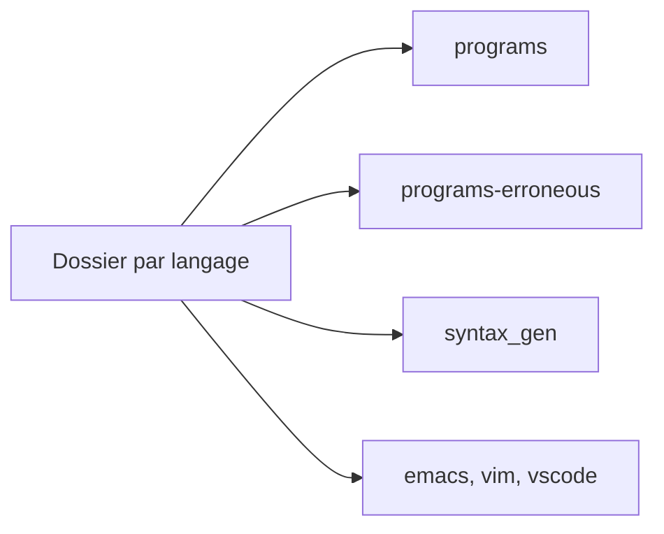

# kostis/ntua_compilers

> Programmes d'exemple et utilitaires pour le cours de compilateurs de l'université technique d'Athènes.

## Le problème
Les étudiants du projet de compilateur ont besoin de programmes valides et erronés pour tester leur travail.

## Ce que ça fait vraiment
Un dossier par langage du projet. Chacun contient des programmes valides avec entrées et résultats, et des programmes erronés. Éventuellement : générateur de programmes aléatoires, coloration syntaxique pour Emacs, Vim/NeoVim, VS Code.

## Comment c'est branché
Schéma simplifié d'après la fiche, sans diagramme fourni.



## Essayer
```bash
# Aucune commande documentée.
```

## Coût et pièges
Gratuit. README court, licence non déclarée, matière insuffisante pour juger davantage.

## Ce que ce n'est pas
Pas un compilateur : seulement des jeux de test.

## Alternatives
Aucune alternative nommée dans le README.

## Pour toi
À ignorer : support de cours de compilation, sans usage direct en data ou IA.

