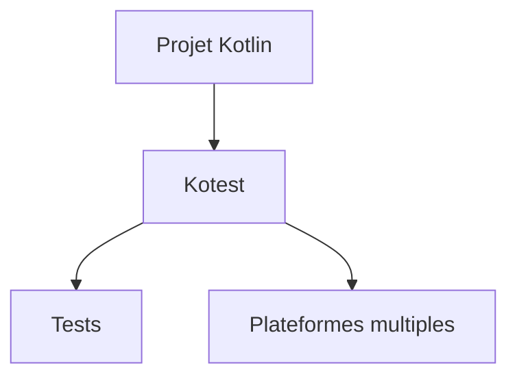

# kotest/kotest

> Flexible, multiplatform testing tool for Kotlin, aimed at Kotlin developers.

## The problem
Writing expressive tests in Kotlin, across several platforms.

## What it actually does
The README is very short: it presents Kotest as a complete testing tool for Kotlin with multiplatform support and points to kotest.io for the getting-started guide. Nothing else is described.

## How it is wired
Simplified diagram based on the sheet, no diagram provided.

## Trying it
No documented command: see kotest.io.

## Cost and gotchas
Free. Not enough material in the README to detail installation, assertions or modules.

## What it is not
Not a Python or data tool. The real content (test styles, integrations) is not described here.

## Alternatives
No alternative named in the README.

## For you
Ignore: it is for testing Kotlin, outside your usual stack.
