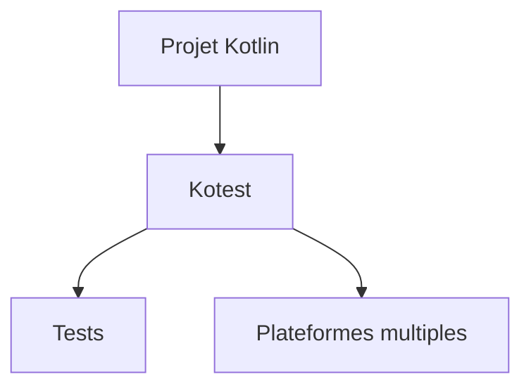

# kotest/kotest

> Outil de test pour Kotlin, flexible et multiplateforme, destiné aux développeurs Kotlin.

## Le problème
Écrire des tests expressifs en Kotlin, sur plusieurs plateformes.

## Ce que ça fait vraiment
Le README est très court : il présente Kotest comme un outil de test complet pour Kotlin avec support multiplateforme et renvoie vers kotest.io pour le guide de démarrage. Rien d'autre n'est décrit.

## Comment c'est branché
Schéma simplifié d'après la fiche, sans diagramme fourni.

## Essayer
Aucune commande documentée : voir kotest.io.

## Coût et pièges
Gratuit. Matière insuffisante dans le README pour détailler l'installation, les assertions ou les modules.

## Ce que ce n'est pas
Pas un outil Python ni data. Le contenu réel (styles de tests, intégrations) n'est pas décrit ici.

## Alternatives
Aucune alternative nommée dans le README.

## Pour toi
Ignorer : sert à tester du Kotlin, hors de ta pile habituelle.

