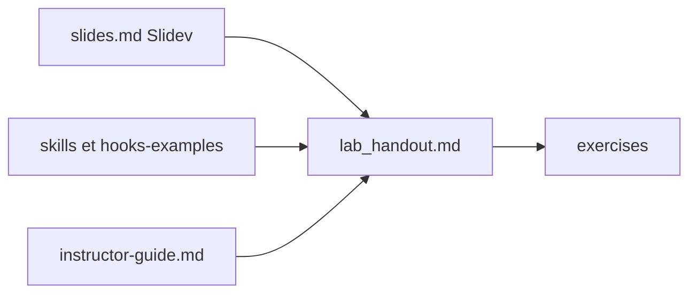

# kousen/claude-code-training

> Course and hands-on exercises for learning Claude Code in a professional development workflow.

## The problem
Getting started with Claude Code (plan mode, skills, hooks, sub-agents) without a structured path amounts to fumbling around.

## What it actually does
The repo contains a Slidev presentation (slides.md), six progressive labs (lab_handout.md), an instructor guide, a glossary, ready-to-copy skills, hook examples, template CLAUDE.md files and exercise projects in Python, TypeScript and Java. It accompanies the book "Claude Code: Up and Running".

## How it is wired
Simplified diagram based on the fiche, no diagram provided.


## Trying it
```bash
pnpm install
pnpm dev
```

## Cost and gotchas
You need Claude Code and a Claude subscription (Pro, Max, Team or Enterprise) or an API key. The README notes that Python, JavaScript and Java environments are required for the labs.

## What it is not
Not a tool: it is training material. Not neutral: it follows the Claude Code framework and does not compare with other agents.

## Alternatives
No alternative named in the README.

## For you
Worth watching: a clear path to structure your use of Claude Code, skills and hooks included, at the price of a Claude subscription.
