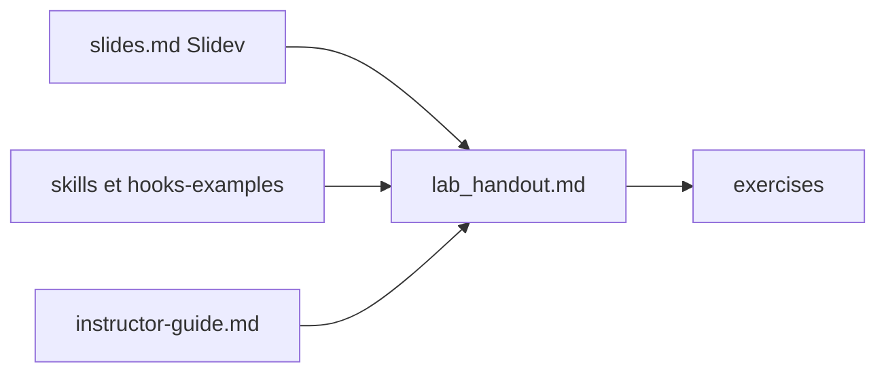

# kousen/claude-code-training

> Cours et exercices pratiques pour apprendre Claude Code dans un flux de développement professionnel.

## Le problème
Prendre en main Claude Code (plan mode, skills, hooks, sous-agents) sans parcours structuré revient à tâtonner.

## Ce que ça fait vraiment
Le dépôt contient une présentation Slidev (slides.md), six travaux pratiques progressifs (lab_handout.md), un guide du formateur, un glossaire, des skills prêts à copier, des exemples de hooks, des fichiers CLAUDE.md modèles et des projets d'exercice en Python, TypeScript et Java. Il accompagne le livre « Claude Code: Up and Running ».

## Comment c'est branché
Schéma simplifié d'après la fiche, sans diagramme fourni.


## Essayer
```bash
pnpm install
pnpm dev
```

## Coût et pièges
Il faut Claude Code et un abonnement Claude (Pro, Max, Team ou Enterprise) ou une clé d'API. Le README signale que les environnements Python, JavaScript et Java sont requis pour les travaux pratiques.

## Ce que ce n'est pas
Pas un outil : c'est un support de formation. Pas neutre : il suit le cadre Claude Code et ne compare pas avec d'autres agents.

## Alternatives
Aucune alternative nommée dans le README.

## Pour toi
À surveiller : un parcours clair pour structurer ton usage de Claude Code, skills et hooks compris, au prix d'un abonnement Claude.

