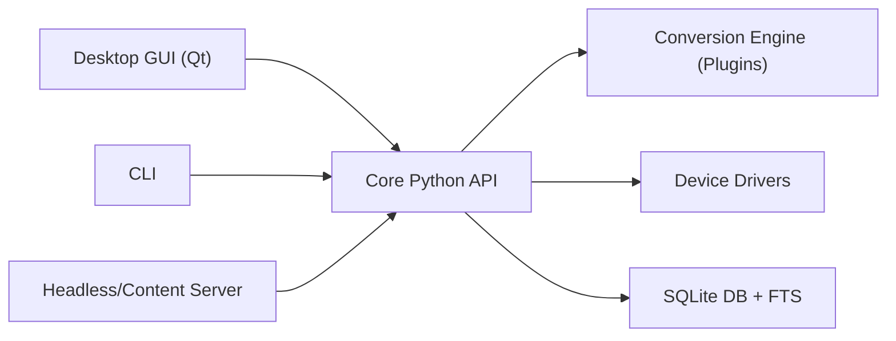

# kovidgoyal/calibre

> E-book manager that reads, converts, edits and catalogs all major formats.

## The problem
E-books exist in incompatible formats, on different devices, with no unified catalog or conversion tool.

## What it actually does
Python/Qt desktop application (Linux, Windows, macOS) that manages a library in SQLite with full-text search, converts between formats through plugins, talks to e-readers, fetches metadata from the Internet and downloads news feeds turned into books. A content server exposes the library to a JavaScript front end. The README sends bug reports to Launchpad; GitHub is only used to host the code.

## How it is wired

## Trying it
No command in the README: it points to the user manual, the build instructions and an archive of the current release.

## Cost and gotchas
Free. Bug reports go to Launchpad, not GitHub. GPL-3.0. Single main maintainer judging by the owner's name.

## What it is not
Not a simple reader: it is a full manager, heavy to install from source. The README is very short and defers everything to external pages.

## Alternatives
- No alternative named in the README.

## For you
Worth watching: useful for converting books and PDFs into a text corpus, with no direct link to data pipelines.
